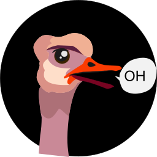

# Custom Twitch Chat



[](https://github.com/LevyArsOS/custom-twitch-chat/actions/workflows/ci.yml)
[](https://github.com/LevyArsOS/custom-twitch-chat/actions/workflows/pages.yml)
[](https://github.com/LevyArsOS/custom-twitch-chat/releases)
[](LICENSE)
[](https://github.com/sponsors/innominata-ltda)
[](README.pt-BR.md)

*[Leia em Português](README.pt-BR.md)*

Standalone, customizable Twitch chat overlay generator and runtime for OBS Browser Source — built to run directly on GitHub Pages or as a self-contained local HTML/ZIP export without external widget platforms.

## Features

- **Direct Twitch IRCv3 WebSocket**: Anonymous connection (`justinfan`) with automatic exponential backoff reconnect, zero third-party chat library overhead.
- **Full Twitch Event Support**: Chat messages, `/me` actions, replies, first-message badges, highlighted messages, Shared Chat (`source-room-id`) origin avatars, subs/resubs/gifts/bulk gifts, bits cheers, incoming raids, announcements, and **Watch Streaks** (`viewermilestone`).
- **Emotes & Badges**: Native Twitch emotes (Unicode code-point aligned), 7TV, BetterTTV, FrankerFaceZ (channel over global), Twemoji, and IVR badge/avatar resolution.
- **In-OBS Twitch OAuth (Optional)**: Uses Twitch **Device Code Grant Flow** (public client, zero secrets) with an in-overlay QR code so tokens stay strictly inside OBS `localStorage` for full Channel Points reward names and Follow events.
- **Two Delivery Modes**:
  1. **Hosted URL**: Compact delta-encoded `#c=1.<base64url>` hash on `overlay.html`.
  2. **Local File Export**: Single self-contained `chat.html` (with SHA-256 CSP hashes) or `.zip` bundle (`chat.html`, `chat.css`, `chat.js`, `config.js`, `config.json`).
- **StreamElements Migration**: Paste or upload your existing `chat.data.json` into the Import box.

## OBS Setup

1. Open the configurator (`index.html` or your GitHub Pages URL) and enter your Twitch channel.
2. Customize typography, colors, borders, emotes, events, or pick a preset (`Default`, `Peneku Chat`, `Minimal`).
3. Choose **Copy Hosted URL** (paste into OBS Browser Source URL) or **Download single `chat.html`** (select **Local file** in OBS Browser Source).
4. Recommended Browser Source settings: **Width 500**, **Height 800**, and keep *Refresh browser when scene becomes active* unchecked.

### Optional OAuth Login inside OBS

1. Register a Twitch application at `https://dev.twitch.tv/console/apps` with Client Type **Public** (Redirect URL: your GitHub Pages URL).
2. Set `TWITCH_CLIENT_ID` as a GitHub Repository Variable (or enter it in the **Twitch Login (OAuth)** section of the configurator).
3. Enable **Twitch Login (OAuth)** in the configurator and export your overlay.
4. In OBS, right-click the Browser Source -> **Interact**, scan the QR code or visit `twitch.tv/activate`, and authorize. Tokens are stored only in OBS `localStorage`.

## Development

```bash
npm install
npm run dev          # Build runtime + start Vite dev server
./scripts/check      # Content policy scan + Vitest (>= 90% coverage) + full build
npm run bench        # IRC parse & tokenize throughput benchmark
```

## License

[MIT](LICENSE) © 2026 LevyArsOS
